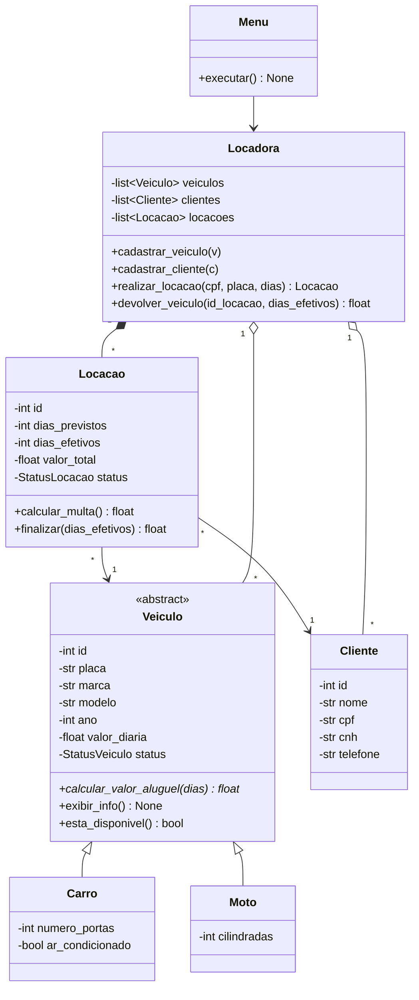

# 🚗 Locadora de Veículos — Python

Aplicação console de uma locadora de veículos, desenvolvida em **Python** com os paradigmas da **Programação Orientada a Objetos**.

Projeto desenvolvido como trabalho acadêmico, seguindo o diagrama de classes e as regras de negócio definidos pelo grupo.

---

## Funcionalidades

- Cadastro de **carros** e **motos**
- Listagem de todos os veículos e apenas dos disponíveis
- Cadastro e listagem de **clientes**
- **Locação** de veículos, com cálculo do valor previsto
- **Devolução** com cálculo de multa por atraso
- Listagem das locações ativas
- Validação de entradas (placa e CPF únicos, números inválidos, veículo indisponível etc.)

---

## Estrutura do projeto

```
LocadoraVeiculos/
└── src/
    ├── enums.py      # StatusVeiculo: DISPONIVEL, ALUGADO, MANUTENCAO / StatusLocacao: ATIVA, FINALIZADA
    ├── veiculo.py    # Veiculo (classe abstrata), Carro e Moto (herdam de Veiculo)
    ├── cliente.py
    ├── locacao.py    # associa Cliente e Veiculo
    ├── locadora.py   # listas e regras de negócio
    ├── menu.py       # interação com o usuário (console)
    └── main.py       # ponto de entrada
```

---

## 🧩 Diagrama de classes



---

## Pilares da Orientação a Objetos

| Pilar | Onde aparece |
|---|---|
| **Encapsulamento** | Todos os atributos são privados (prefixo `_`), com acesso por `@property`. Apenas o que pode mudar depois do cadastro tem setter. |
| **Herança** | `Carro` e `Moto` herdam de `Veiculo` (`class Carro(Veiculo)`). |
| **Abstração** | `Veiculo` herda de `ABC` e tem um `@abstractmethod`: não é possível instanciar um veículo genérico. |
| **Polimorfismo** | `calcular_valor_aluguel()` e `exibir_info()` são sobrescritos em cada subclasse. `Locacao` e `Locadora` trabalham com `Veiculo` sem saber se é carro ou moto. |
| **Associação / Composição** | `Locacao` referencia um `Cliente` e um `Veiculo`; `Locadora` mantém as listas de veículos, clientes e locações. |

---

## Regras de negócio

**Valor do aluguel**
- **Carro:** `valor_diaria × dias`, mais `R$ 15,00 × dias` se tiver ar-condicionado
- **Moto:** `valor_diaria × dias`, com acréscimo de **10%** se `cilindradas > 500`

**Devolução e multa**
- `dias_extras = dias_efetivos − dias_previstos` (mínimo 0)
- `multa = dias_extras × valor_diaria × 1,5`
- `valor_total = calcular_valor_aluguel(dias_efetivos) + multa`

**Validações**
- Placa e CPF não podem se repetir
- Só é possível alugar um veículo com status `DISPONIVEL`
- A quantidade de dias deve ser no mínimo 1
- Ao alugar, o veículo passa para `ALUGADO`; ao devolver, volta para `DISPONIVEL` e a locação fica `FINALIZADA`

---

## Como executar

**Requisito:** Python **3.8** ou superior.

Pelo terminal, na pasta do projeto:

```bash
python src/main.py
```

Ou abra a pasta em uma IDE (PyCharm ou VS Code) e execute o arquivo `src/main.py`.

---

## Menu

```
===== LOCADORA DE VEÍCULOS =====
1 - Cadastrar carro
2 - Cadastrar moto
3 - Listar veículos
4 - Listar veículos disponíveis
5 - Cadastrar cliente
6 - Listar clientes
7 - Realizar locação
8 - Devolver veículo
9 - Listar locações ativas
0 - Sair
Escolha uma opção:
```

### Exemplo de cálculo

Fiat Argo com ar-condicionado, diária de R$ 120,00, alugado por 3 dias e devolvido em 5:

| Item | Cálculo | Valor |
|---|---|---|
| Valor previsto | 120 × 3 + 15 × 3 | R$ 405,00 |
| Aluguel efetivo | 120 × 5 + 15 × 5 | R$ 675,00 |
| Multa | 2 × 120 × 1,5 | R$ 360,00 |
| **Total** | | **R$ 1.035,00** |

---

Trabalho desenvolvido para a disciplina de Paradigmas da Programação da faculdade Veiga de Almeida, 2026.
